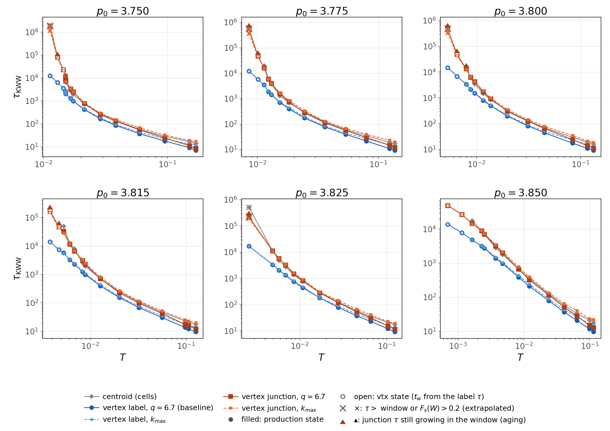
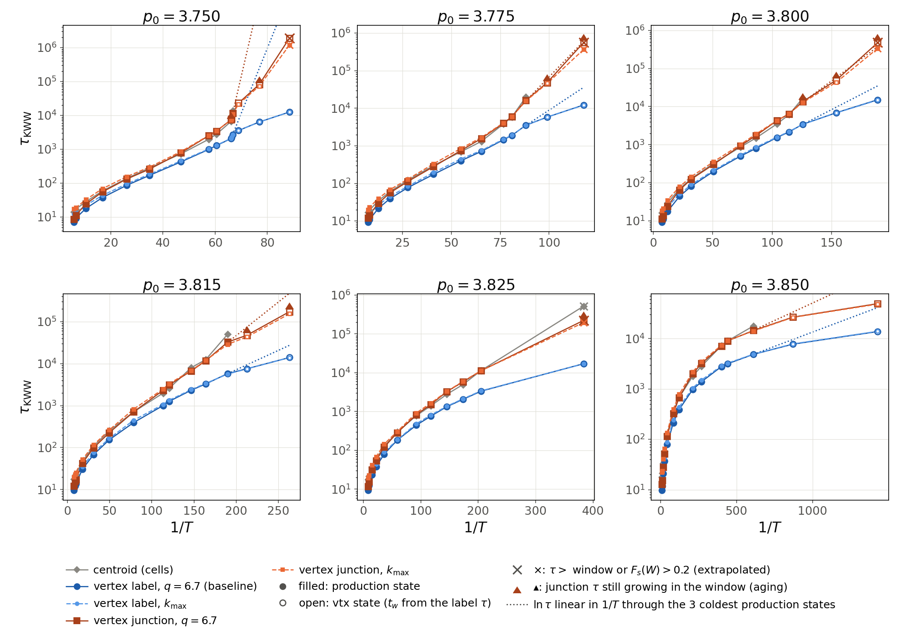
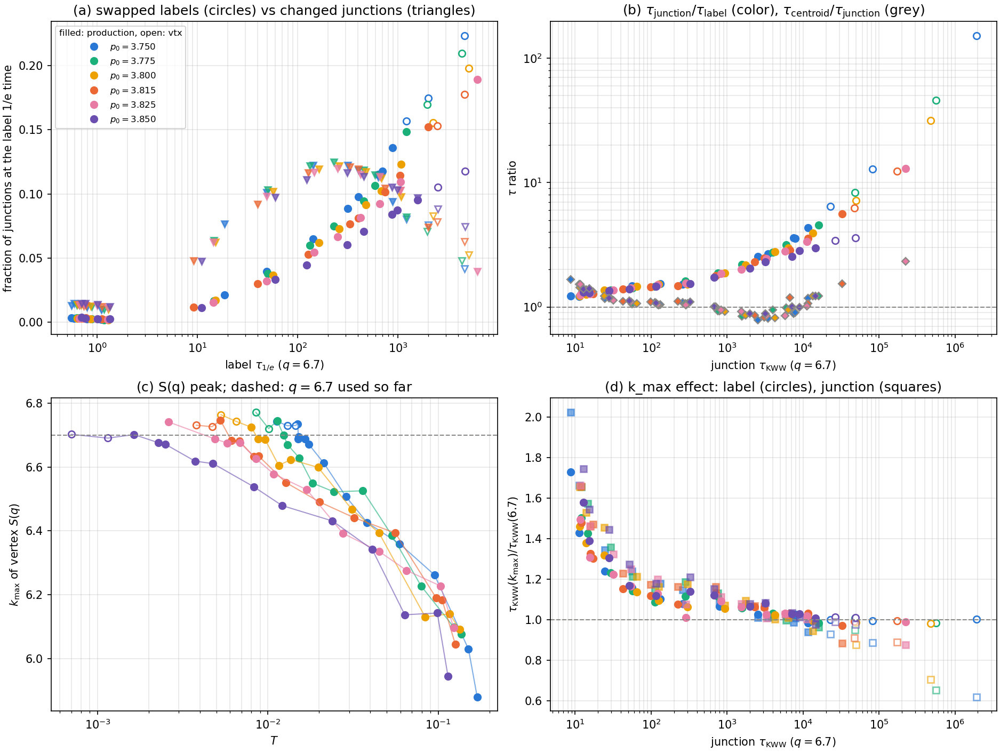

# Cold vertex-position \(\tau_\alpha\) bends because T1 flicker swaps vertex labels, not because of \(q\)

Generated by Claude Code. 2026-11-02. Vertex production trajectories, \(N=4096\), 70 production + 11 vtx states, idx \(0..9\) (all 10 replicas of every state).

The vertex-position \(F_s^{\mathrm{CR}}\) follows each vertex by its array label. In cellGPU a T1 always turns the short edge \(v_1\to v_2\) (\(v_1<v_2\)) by \(+90^\circ\) (`vertexModelBase::performT1TransitionCPU`), so a T1 and its reverse turn it by \(180^\circ\). The cells are then exactly as before, but the two labels have traded junctions, each moving about one edge length (0.64). At \(q=6.7\) that decorrelates the vertex (\(J_0(4.3)\approx-0.4\)) although nothing in the tissue changed. On cooling the structure slows down much faster than this edge flicker, so the label \(\tau\) turns into a flicker time and bends below the structural trend. The vtx states are deep in that regime.

- **\(k_{\max}\) is not the cause.** The vertex \(S(q)\) peak is at 6.62–6.77 wherever the label \(\tau>10^3\) (6.69–6.77 in the vtx states). There \(\tau(k_{\max})/\tau(6.7)=0.97\)–1.08, and 0.98–1.01 at the vtx states. A state-dependent \(k_{\max}\) mainly moves the hot end: \(+20\)–\(70\%\) for \(\tau<30\), where \(k_{\max}=5.9\)–6.3.
- **Fix: follow junctions, not labels.** A junction is its three cells (`VertexCellNeighbors`). Tracking the label that holds the \(t_0\) triplet undoes the swaps. The junction \(\tau_{\mathrm{KWW}}\) then equals the cell-centroid \(\tau_{\mathrm{KWW}}\) (median ratio 0.93 over the 70 production states, 5–95%: 0.66–1.20), with the same smooth trend in \(T\) for every \(p_0\).
- **The vtx states are not equilibrated on this clock.** Their \(t_w\) came from the label \(\tau\), which is 3–150× too short. \(t_w=0.1\)–4.3 junction \(\tau\), and 7 of the 11 age measurably in the window. They need longer runs before they can sit on the curve.

Blue: label tracking (the published baseline, \(q=6.7\), and at \(k_{\max}\)). Red: junction tracking. Grey: centroid round 2. Open: vtx states; \(\times\): \(\tau\) beyond the window or \(F_s(W)>0.2\) (KWW extrapolation); \(\blacktriangle\): junction \(\tau\) still growing in the window. Dotted: \(\ln\tau\) linear in \(1/T\) through the three coldest production states.

## What is measured

`vertex_position_fs_kscan.py` reads every trajectory (810) and computes, from the stored positions, `Vneighs` and `VertexCellNeighbors`:

- \(F_s^{\mathrm{CR}}(q,t)=N_v^{-1}\sum_j J_0(q|\Delta\mathbf r_j^{\mathrm{CR}}|)\), cage = 1-hop ∪ 2-hop mesh neighbours at \(t_0\), on 37 \(q\) (5.40–7.12 and 6.7), from 4 time origins. The label version reproduces the C++ `vertexPositionFs.out` files to \(5\times10^{-15}\), and the replica means reproduce the committed `Fs_combined_mean.csv` to \(2\times10^{-15}\).
- Junction version: \(\Delta\mathbf r_j\) is taken from the label that holds \(j\)'s \(t_0\) cell triplet at \(t\); if the triplet is gone (a T1 that was not undone) the label's own displacement is used. No two vertices ever share a triplet (checked in every frame).
- Two-time \(F_s(t_k\to t_j)\) at \(q=6.7\) for every pair of records (aging test). Fractions of \(t_0\) junctions held by another label (swapped) or gone (dead).
- Vertex \(S(q)\) on the C++ grid; the \(k_{\max}\) of the 69 old states reproduces `sq_first_peak.csv` exactly.

`combine_vertex_position_fs_kscan.py` builds the replica means, then the same global KWW fit as the baseline (`--tail last_rise --hot-peak 0.32 --hot-fs-max 0.1 --hot-extra 3`, seed 42) runs on label/junction × \(q=6.7\)/\(k_{\max}\). All four fits: \(\hat R=1.000\), bulk ESS \(\ge3700\), no divergences. Shared \(A,\beta\): label 0.567, 0.717; junction 0.558, 0.623.

## 1. Labels swap, junctions stay

- **(a)** At the label \(1/e\) time, the fraction of swapped labels grows on cooling: 0.01–0.04 at \(\tau_{1/e}\sim10\)–60, 0.09–0.15 at the coldest production states, 0.10–0.22 in the vtx states. The fraction of junctions that really changed peaks near 0.12 at \(\tau_{1/e}\sim10^2\)–\(5\times10^2\) and then falls to 0.04–0.09. Above \(\tau_{1/e}\approx10^3\) swapped labels outnumber changed junctions.
- One replica of \(p_0=3.750\), \(T=0.0113\) at \(t=3162\): 17% of labels swapped, 80% of them in pairs, 92% with a \(t_0\) edge neighbour. A swapped label moved 0.69 (the edge was 0.64), the junction it left moved 0.31, the same as an unswapped vertex. By the end of the window the labels have wandered 1.8 by repeated flips while the junctions moved 0.36.
- **(b)** \(\tau_{\mathrm{junction}}/\tau_{\mathrm{label}}\) falls on one curve for all \(p_0\) (3.850 a little lower): 1.2–1.4 in the hot fluid, 3.0–5.6 at the coldest production states, 3.4–13 in the vtx states that are resolved (31–150 where the junction \(\tau\) is extrapolated). \(\tau_{\mathrm{centroid}}/\tau_{\mathrm{junction}}\) is 0.92–1.13 for \(30\le\tau_{\mathrm{jn}}<10^3\) and 0.78–1.23 above. Two exceptions: \(p_0=3.815\), \(T=0.00526\) (1.54) and \(p_0=3.825\), \(T=0.0026\) (2.3, not equilibrated). In the hot fluid (\(\tau<30\)) it is 1.2–1.7, where both fits use only the short \(F_s\le0.1\) tails.
- **(c, d)** \(k_{\max}\) rises from 5.9–6.3 (hot) to 6.62–6.77 and never exceeds 6.7 by more than 0.07.

So the label \(\tau\) has two channels: structural relaxation, and flicker swaps, whose rate grows much more slowly on cooling. The original batch already sits in the crossover (label \(\tau\) 3–5.6× below the junction \(\tau\) at the coldest states); the vtx states are past it.

## 2. With junction tracking the vtx states are not equilibrated

`plot_vertex_position_fs_aging.py`: per replica, \(F_s\) at lag \(\tau_0\) from late origins (\(t_k\ge W/4\), age \(\approx1.3\)–\(1.5\,t_w\)) minus that from the first record, both interpolated on the late origin's lags. Then \(\ln(\tau_{\mathrm{late}}/\tau_0)=\bar d/s\), with \(s=-\partial F_0/\partial\ln t\) at \(\tau_0\).

| \(p_0\) | \(T\) | kind | \(t_w/\tau_{0}^{\mathrm{jn}}\) | \(\tau_{\mathrm{late}}/\tau_0\) junction | label |
|---|---|---|---|---|---|
| 3.750 | 0.0145 | vtx | 14.6 | 1.11 ± 0.08 | 0.97 |
| 3.750 | 0.0130 | vtx | 6.7 | **1.53 ± 0.17** | 1.05 |
| 3.750 | 0.0113 | vtx | 2.4 | 1.19 ± 0.13 | 1.03 |
| 3.775 | 0.0101 | vtx | 7.4 | **1.21 ± 0.11** | 1.00 |
| 3.775 | 0.0085 | vtx | 3.3 | **1.27 ± 0.10** | 1.02 |
| 3.800 | 0.00796 | production | 26.7 | **1.39 ± 0.09** | 1.03 |
| 3.800 | 0.0065 | vtx | 7.9 | **1.30 ± 0.10** | 1.01 |
| 3.800 | 0.0053 | vtx | 2.8 | **1.59 ± 0.19** | 1.04 |
| 3.815 | 0.0047 | vtx | 7.4 | **1.22 ± 0.08** | 1.00 |
| 3.815 | 0.0038 | vtx | 4.6 | **1.45 ± 0.17** | 1.00 |
| 3.825 | 0.00261 | production | 3.5 | **1.49 ± 0.17** | 1.00 |
| 3.850 | 0.00115 | vtx | 12.7 | 1.04 ± 0.04 | 1.00 |
| 3.850 | 0.0007 | vtx | 9.3 | 1.09 ± 0.07 | 0.98 |

(\(\tau_0\): \(1/e\) time of the first-record curve. Bold: \(>2\) SEM. Full table: `aging_summary.csv`.)

- The other production states show no aging (ratios 0.92–1.14, none above 2 SEM except \(p_0=3.750\), \(T=0.01513\): 1.12 ± 0.05).
- The label \(\tau\) does not age anywhere (0.95–1.07). Flicker equilibrates fast, so the baseline looked clean while the structure was still ordering (\(|\Psi_6|\) drift in `vertexModel_hexatic`).
- With aging the first-record \(\tau\) is a lower bound. That is why the vtx junction points at \(p_0=3.750\) and 3.815 fall below the extrapolated production trend, while at 3.775 and 3.800 they land on it (0.80–1.28 of the line).
- Three vtx2e4 states (3.750/0.0113, 3.775/0.0085, 3.800/0.0053) and 3.825/0.0026 have junction \(\tau_{\mathrm{KWW}}\) beyond the window (\(2\times10^5\)–\(2\times10^6\)): the KWW tail is extrapolated.

## Recommendation

- Use junction tracking for the vertex-position \(\tau_\alpha\) from now on. Keep \(q=6.7\); a state-dependent \(k_{\max}\) changes only the hot end and is not needed for the cold trend.
- For the cold end, redo the vtx states with \(t_w\ge10\,\tau_{\mathrm{jn}}\), or pick new \(T\) from the junction (= centroid) trend. Rough cost at \(\sim3\times10^4\) time units per CPU-hour (vtx2e4 runs: \(4\times10^5\) in 13 h), for \(t_w=W=10\,\tau_{\mathrm{jn}}\): \(\tau_{\mathrm{jn}}=2.5\times10^4\) needs 17 h, \(5\times10^4\) needs 33 h, \(\ge8\times10^4\) needs more than the 48 h limit (the driver has no checkpoint).

## Files

- `vertex_position_fs_kscan.py` (SLURM `23449685`, 64 cores, 4 min) → `$CELLGPU_SCRATCH/N4096/vertex/productionRuns/vertexPositionFsKScan/kscan_*.npz`.
- `combine_vertex_position_fs_kscan.py` → `Fs_combined_mean_{label,junction}_{q6.700,kmax}.csv`, `kmax.csv`, `junction_fractions.csv`, `tau_1e.csv`.
- `fit_vertex_fs_kww_hmc.py`, `plot_vertex_fs_kww.py`, `plot_vertex_fs_tail_collapse.py` → `kww_{label,junction}_{q6.700,kmax}/` (and `kww_junction_q6.700_perp0/`, one \(A,\beta\) per \(p_0\)).
- `plot_vertex_position_fs_kscan_tau.py` → `tau_kww_variants.csv`, `tau_kww_vs_T_variants.png`, `tau_kww_vs_invT_variants.png`.
- `plot_vertex_position_fs_aging.py` → `aging_summary.csv`, `aging_tau_ratio.png`. `plot_vertex_position_fs_swaps.py` → `swap_summary.csv`, `swap_mechanism.png`.
